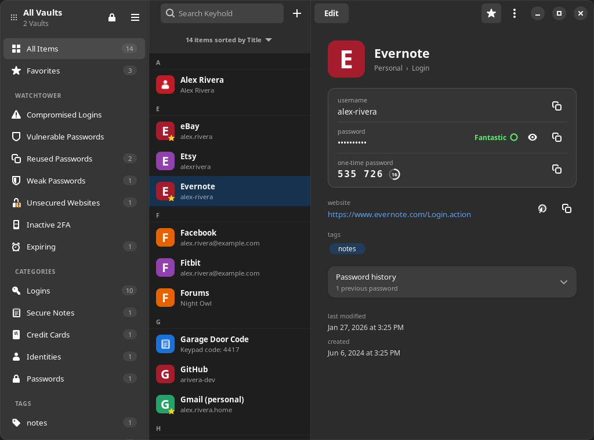
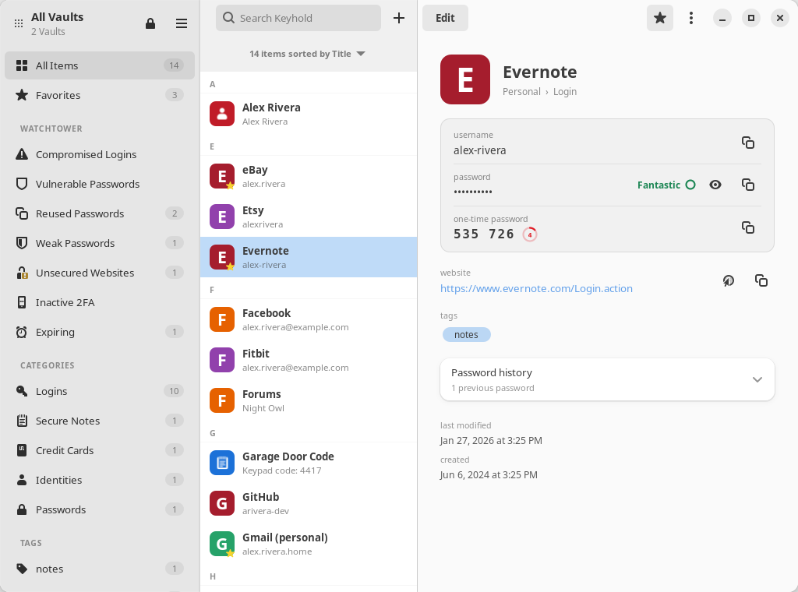
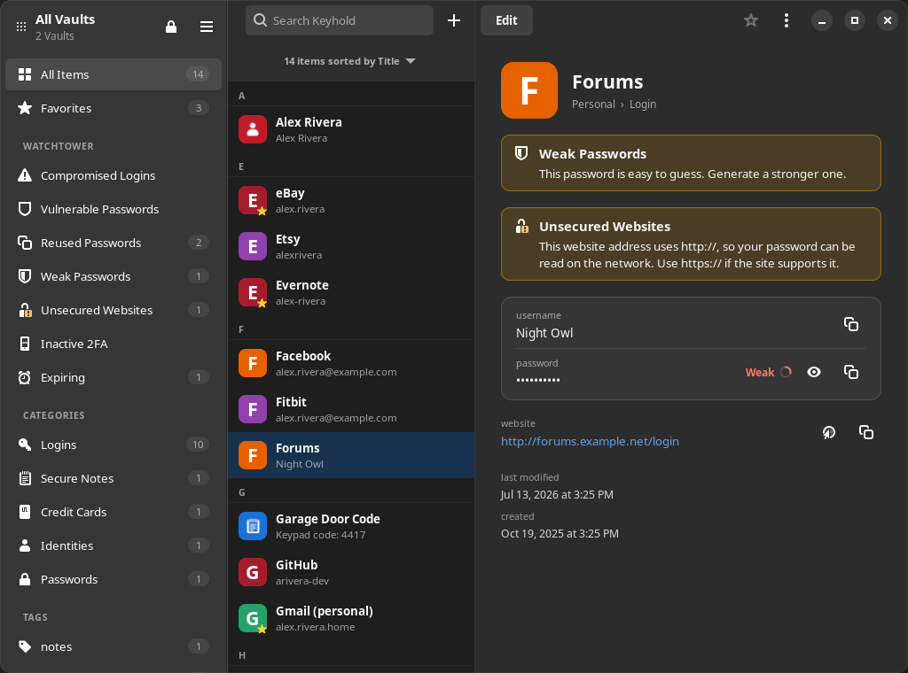
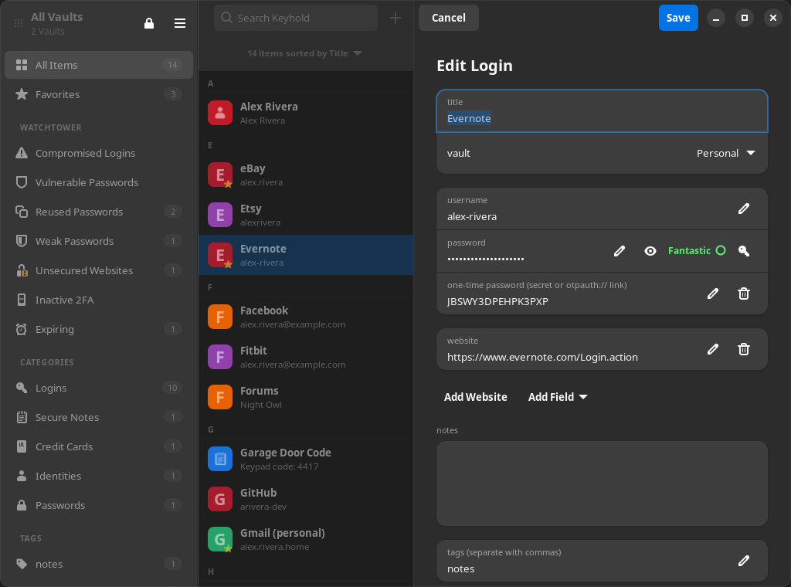
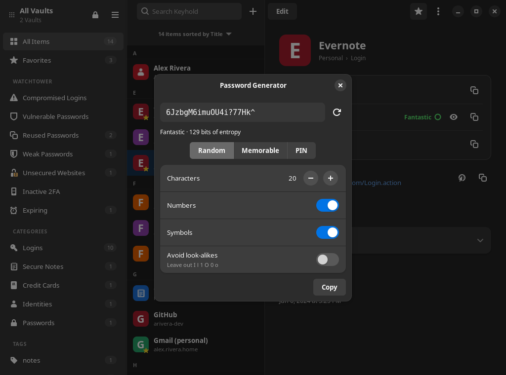
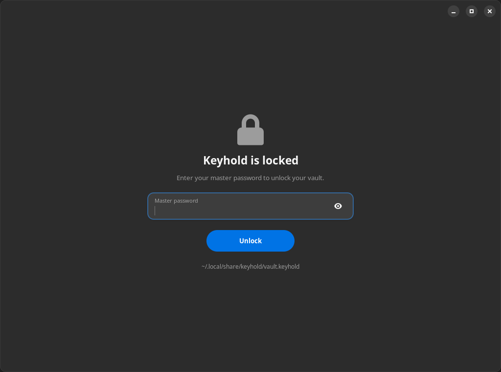
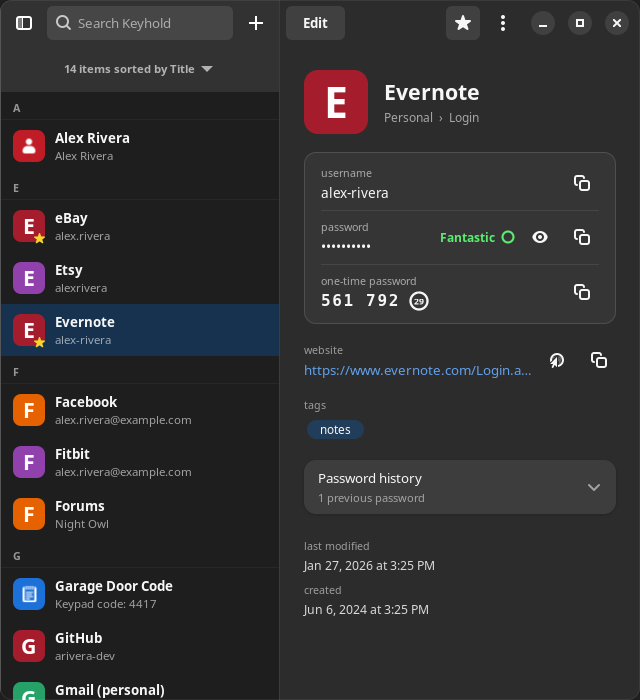

# Keyhold

A password manager for Linux that keeps your vault on your own computer, encrypted.
It has a three-pane layout: vaults and Watchtower on the left, items in the middle, details on the right.
It is built with GTK 4 and libadwaita.

Keyhold has no account, no cloud and no sync. Nothing leaves your computer unless you
turn on Watchtower's online checks (see below).



## Screenshots

All screenshots use a made-up demo vault (`tools/demo_data.py`).

| | |
| --- | --- |
|  |  |
| **Light style.** Follows your choice in Preferences. | **Watchtower.** Explains what's wrong with an item and what to do. |
|  |  |
| **Editing.** Strength rating, built-in generator, custom fields. | **Generator.** Random, memorable words or PIN, with entropy shown. |
|  |  |
| **Locked.** Auto-locks when idle, on screen lock and before sleep. | **Narrow windows.** The sidebar folds away behind a button. |

## Install and run

### Linux

You need GTK 4 and libadwaita for Python. They're already present on Ubuntu 24.04 with GNOME;
otherwise run `sudo apt install python3-gi gir1.2-gtk-4.0 gir1.2-adw-1`.

```sh
git clone https://github.com/mish1102/keyhold.git
cd keyhold
./install.sh            # adds "Keyhold" to your app menu and a `keyhold` command
keyhold
```

`./install.sh --uninstall` removes the launcher, menu entry and icon. Your vault stays where it is.

### macOS (experimental)

> **Not yet tested on a real Mac.** The installer and the macOS code paths have only been
> checked on Linux. Please report what happens.

1. Install [Homebrew](https://brew.sh) if you don't have it.
2. Install Python, GTK 4 and libadwaita:
   ```sh
   brew install python gtk4 libadwaita pygobject3 adwaita-icon-theme librsvg
   ```
3. Get Keyhold and install it:
   ```sh
   git clone https://github.com/mish1102/keyhold.git ~/keyhold
   cd ~/keyhold
   ./install.sh
   ```
   This creates **Keyhold.app** in `~/Applications` (find it with Spotlight or Launchpad)
   and a `keyhold` command in `~/.local/bin`.
4. Open Keyhold and create your vault.

Keep the `keyhold` folder where you cloned it: the app runs from there. To update, run
`git pull` in that folder. To remove the app, run `./install.sh --uninstall` (your vault stays).

How it differs on a Mac:

- **Shortcuts:** use ⌘ instead of Ctrl (⌘L locks, ⌘⇧C copies the password, and so on).
- **Where data lives:** `~/Library/Application Support/Keyhold/`.
- **Locking:** Keyhold doesn't yet notice when the Mac's screen locks or the Mac goes to sleep;
  it only locks after inactivity or when you press ⌘L. Set a short auto-lock time in
  Preferences, and lock it yourself before you walk away.
- **Clipboard managers:** copied passwords are still cleared after 90 seconds. But Mac clipboard
  managers (Alfred, Raycast, Paste, …) may not recognize them as secret, so they could keep them
  in their history. Exclude Keyhold in your clipboard manager's settings.
- **Look and feel:** it looks like a GNOME app, not a native Mac app.

**Moving between Linux and a Mac:** the vault format is the same, so you can copy
`vault.keyhold` from one computer to the other and unlock it with the same master password.
There's no sync. If you edit on both, the copy you move last replaces the other, so pick one
computer as the main one.

### Run without installing

After `./install.sh` has set up `.venv` once, you can run `.venv/bin/python -I -m keyhold`
from the folder.

## Features

- **Item types:** logins, passwords, secure notes, credit cards, identities and bank accounts.
- **Organizing:** multiple vaults, favorites, tags and a Trash with restore.
- **Fields:** custom fields of any type, and multiple websites per login.
- **Password history:** every password change keeps the old value.
- **One-time codes:** live codes with a countdown. Paste the secret or an `otpauth://` link.
- **Password generator:** random, memorable words (EFF wordlist) or PIN. A strength rating is shown everywhere.
- **Watchtower** lists:
  - weak, reused and unsecured (`http://`) logins
  - cards that are expiring or have expired
  - with online checks on: compromised logins, vulnerable passwords and inactive 2FA
- **Import** from Chrome/Edge/Brave, Firefox, Safari, Bitwarden (CSV or unencrypted JSON),
  1Password (CSV or `.1pux`), KeePassXC, LastPass and generic CSV. After importing, Keyhold
  offers to delete the unencrypted export file.
- **Export** an encrypted backup, or plain CSV (asks for your master password first).

## Keyboard shortcuts

On a Mac, use ⌘ wherever the table says Ctrl.

| Keys | Action |
| --- | --- |
| Ctrl+F | Search |
| Ctrl+N | New login (the + menu has the other types) |
| Ctrl+E / Ctrl+S | Edit / save the selected item |
| Ctrl+Shift+C / U / O | Copy password / username / one-time code |
| Ctrl+G | Password generator |
| Ctrl+L | Lock |
| Ctrl+, | Preferences |

## Where your data lives

| What | Linux | macOS |
| --- | --- | --- |
| Vault (encrypted) | `~/.local/share/keyhold/vault.keyhold` | `~/Library/Application Support/Keyhold/vault.keyhold` |
| Automatic backups (encrypted) | `~/.local/share/keyhold/backups/` | `~/Library/Application Support/Keyhold/backups/` |
| Theme and window size (not secret) | `~/.config/keyhold/config.json` | `~/Library/Application Support/Keyhold/config.json` |

Backups keep the 10 most recent saves, plus one per day for 30 days.

The first save after each unlock copies the previous vault into `backups/`. A backup opens
with the master password that was in use when it was made.

When you change your master password:
- Keyhold first backs up the vault under the old password.
- Then it writes the new file and checks that it reads back correctly.
- The backups that still open with the old password are removed only after you've unlocked
  once with the new password. If you mistype the new password the same way twice, you can
  still get back in.

**Keep your own copy too:** use *Export → Encrypted Backup…* now and then, and store the
file off this computer (USB drive, another machine).

## Security design

- **Key derivation:** Argon2id (256 MiB, 3 iterations, 4 lanes) turns your master password
  into a key-encryption key. Unlocking takes about 1.5 s; that cost is what slows down
  anyone trying to guess your password from a stolen vault file.
- **Encryption:** a random 256-bit vault key, wrapped by that key, encrypts the whole vault with
  ChaCha20-Poly1305. Every save uses a fresh random nonce. The header (format, KDF settings)
  is authenticated, so tampering makes the file refuse to open instead of opening weakened.
- **Saving:** writes are atomic (temp file + fsync + rename). A crash or a full disk can't
  damage the existing vault; Keyhold shows a "not saved" banner with a retry button.
- **File access:** files are created `0600` in a `0700` folder. An exclusive lock stops two
  copies of Keyhold from writing the same vault.
- **Locking:**
  - Keyhold locks after inactivity (default 10 minutes, counting time asleep). On Linux it
    also locks when the screen locks and before the computer sleeps.
  - Locking wipes and closes any open dialogs.
  - An edit you were in the middle of, or a change that couldn't be saved, is kept
    encrypted in memory and restored when you unlock.
  - Quitting with unsaved work asks first.
- **Clipboard:** copied secrets are cleared after 90 seconds, but only if the clipboard still
  holds what Keyhold put there. They are marked `x-kde-passwordManagerHint: secret`, so
  Linux clipboard managers that honor the hint (Klipper, CopyQ, GPaste) don't keep them in their history.
- **Process hardening:**
  - Core dumps are disabled and the process is marked non-dumpable, which blocks same-user
    debuggers from reading its memory.
  - The launcher runs Python in isolated mode (`-I`), so nothing from the current folder,
    `PYTHONPATH` or `~/.local` can load into it.
  - Copy shortcuts aren't exposed as window actions, which other programs could trigger over D-Bus.
  - Imports are limited in size (64 MB, and 256 MB unpacked for `.1pux`).
- **Online checks (off by default):**
  - Only the first 5 characters of each password's SHA-1 hash are sent to Have I Been Pwned,
    which uses k-anonymity, with padded responses.
  - The breach list and the 2FA Directory list are downloaded whole, so nothing about your sites is sent.
  - Results are stored inside the encrypted vault.

### Limitations, honestly

- **No sync, no browser autofill, no mobile app.** You copy and paste, or use the shortcuts above.
- **Secrets in memory:** Python can't reliably wipe them, so decrypted values can stay in
  process memory until Keyhold exits. Lock or quit when you step away from an unlocked computer.
  The vault key itself is zeroed on lock.
- **Swap and disk encryption:** that memory can be written to swap. On a computer without
  full-disk encryption (or at least encrypted swap), someone who takes the disk could find
  passwords in the swap file, or in deleted export files, without needing your master password.
  Turn on full-disk encryption if you can.
- **No recovery:** if you forget your master password, your data can't be recovered. That's the
  point of the encryption.
- **Not audited:** this is new software that no outside security firm has reviewed. Keep an
  encrypted backup, and keep your old password manager until you trust this one.
- **CSV export:** values are written exactly as stored. Avoid opening it in a spreadsheet app, which may
  run cells starting with `=` as formulas. Delete it when you're done.

## Development

```sh
.venv/bin/python -m pytest                      # unit tests
gtk4-broadwayd :7 &                             # headless display for the UI checks
GDK_BACKEND=broadway BROADWAY_DISPLAY=:7 .venv/bin/python tools/smoke.py       # end-to-end UI test
GDK_BACKEND=broadway BROADWAY_DISPLAY=:7 .venv/bin/python tools/screenshot.py screenshots
```

Both tools use a throwaway vault in a temp folder and never touch your real one.

### Layout

- `keyhold/crypto.py`: key derivation, key wrapping, file format
- `keyhold/store.py`: atomic saves, backups, locking, password change
- `keyhold/model.py`: items, fields, categories, vaults, settings
- `keyhold/listing.py`: filtering, search, sorting, grouping
- `keyhold/totp.py`: one-time codes (RFC 6238)
- `keyhold/generator.py`: generator (plus `eff_large_wordlist.txt`)
- `keyhold/strength.py`: strength meter
- `keyhold/watchtower.py`, `keyhold/watchtower_online.py`: security checks
- `keyhold/importers.py`: import and CSV export
- `keyhold/ui/`: GTK interface

## License

Keyhold's code is released under the MIT License (see [LICENSE](LICENSE)). The bundled
passphrase wordlist is the EFF's, under CC BY 3.0 US (see Credits).

## Credits

Passphrase words come from the [EFF Large Wordlist](https://www.eff.org/dice) (CC BY 3.0 US).
Breach data comes from [Have I Been Pwned](https://haveibeenpwned.com), and 2FA support data from
[2FA Directory](https://2fa.directory). Both are used only when online checks are turned on.
